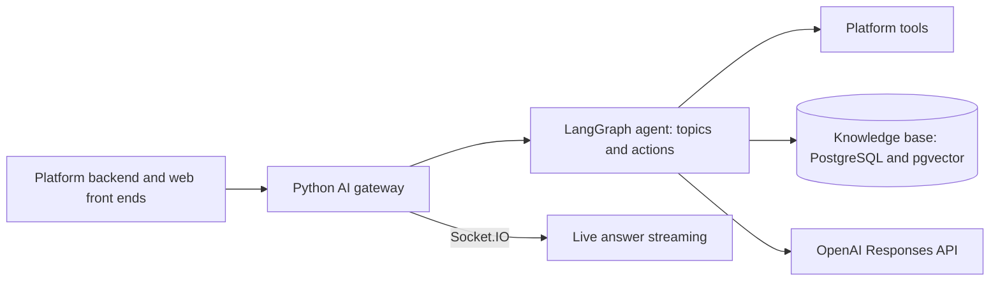

# AIHub — AI gateway for a white-label AI platform

**Period:** June 2025–January 2026
**Ownership:** Independent contract (commercial)
**Role:** AI engineer (AI gateway) and acting DevOps

AIHub is a white-label AI platform for businesses, covering AI marketing and education guidance. I built its Python AI gateway: the platform's Java backend calls it for knowledge-base answers and structured AI reports, and it streams answers back to users in real time. I also acted as DevOps for the platform.

## Platform

- **Agent** — a topic-and-action agent on LangGraph: platform topics declare actions, and the agent decides when to call them and chains retrieval into explanation.
- **Knowledge base** — document collections with chunking, AI metadata extraction, semantic search with metadata filters, and PDF ingestion, on PostgreSQL with pgvector.
- **Model layer** — an LLM adapter on the OpenAI Responses API, with reasoning controls and web search.
- **Streaming** — answers and reasoning steps streamed to the right client over Socket.IO.
- The platform backend and web front ends were built by others; the gateway is the AI layer they call.

## My contribution

- Designed and built the gateway's agent flow, knowledge base, model layer and real-time streaming.
- Migrated the agent to LangGraph 1.0, rewrote database access to be async, and added a two-stage Docker build.
- Acting DevOps for the platform: AWS hosting (EC2, S3, CloudFront, ALB, IAM, CloudWatch), CI/CD pipelines and Docker deployments.

**Key technologies:** Python, FastAPI, LangGraph, LangChain, OpenAI Responses API, PostgreSQL, pgvector, Socket.IO, Docker, AWS
