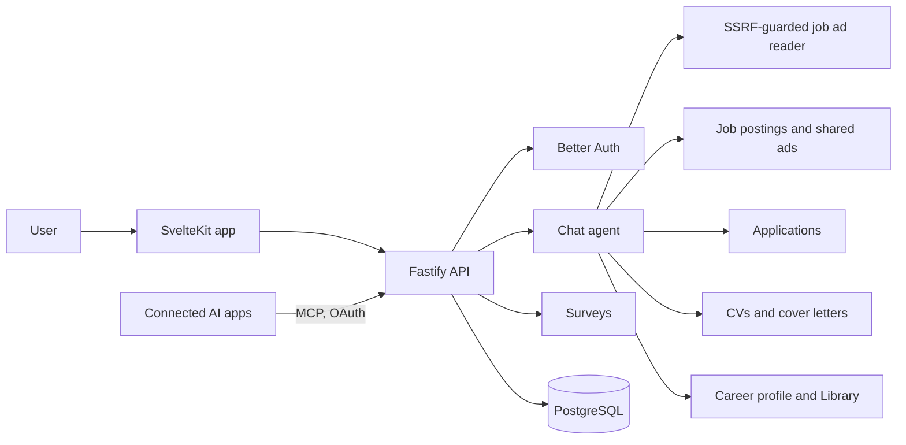

# Briefed — AI assistant for tech job seekers

**Period:** August 2026–Present  
**Ownership:** Founder-led  
**Role:** Founder / full-stack AI engineer  
**Live:** [briefed.cv](https://briefed.cv)

Your tech job search, briefed. Briefed is an AI assistant for tech job seekers: briefings from real applicants on the tech job ads you face, and CVs and cover letters built only from your own record. You chat with it to read a job ad, check it before applying, track the application and write a tailored CV, and every record it offers waits for your confirmation.

Interview briefings from real applicants: coming soon

## Platform

- **Job ads** — reads an ad from a link, PDF or pasted text, including script-rendered career sites. Posting checks flag requirements that could rule you out, and shared ads carry marks from real applicants such as reposts and warning signs.  
- **Applications** — tracked from an ad or by hand, with a progress timeline of real dates, notes per posting and application, and a Submitted mark on the CV that was sent.  
- **CVs and cover letters** — tailored per posting as reviewable drafts that follow your own CV templates, editable by hand, with a draft panel beside the chat.  
- **Chat agent** — reads every card it put on screen, lets you correct a proposal before saving it, adapts its reasoning effort per turn with a "Think harder" rerun, and loads built-in skills.  
- **Grounding checks** — titles, years and the key technologies line are checked against your own record, so the agent cannot invent experience.  
- **Connected AI apps** — an MCP server with OAuth lets your own AI apps read your job postings, career profile and Library and write Library notes, revocable under Settings.  
- **Surveys** — branching questions, public answer pages that need no account, and results shared with respondents.  
- **Security** — multi-account isolation, Better Auth sign-in with email or Google, and an SSRF-guarded link fetcher.  

## My contribution

- Product, agent and platform design end to end.  
- Over 5,000 automated tests covering the grounding guards, SSRF rules and cross-account isolation.

**Key technologies:** TypeScript, SvelteKit 2 / Svelte 5, Tailwind CSS 4, Fastify 5, Drizzle ORM, PostgreSQL (Supabase), Better Auth, Vercel AI SDK, MCP, OAuth, Zod 4, Vitest, Vercel
