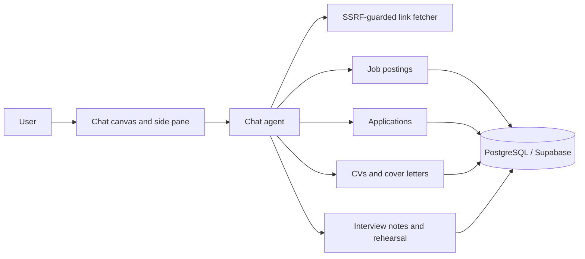

# Briefed — AI career agent

**Period:** August 2026–Present  
**Ownership:** Founder-led  
**Role:** Founder / full-stack AI engineer  
**Live:** [briefed.cv](https://briefed.cv)

Briefed is a conversational AI career agent. It reads job adverts from a link, PDF or pasted text, extracts structured postings, tracks applications, and generates CVs and cover letters grounded only in the user's own career facts. It is deployed on Vercel with Supabase (PostgreSQL).

## Platform

- **Chat canvas** — persistent conversations with a side pane of tabs: side chats, the CV draft being written, its diff, and any record opened from a card.  
- **Job postings and applications** — searchable postings with full advert details, and applications with current status and an append-only status history.  
- **CVs and cover letters** — tailored per posting as reviewable draft revisions with Show changes, Plain and Rendered views, and Print / save as PDF; reusable CV variants for base versions.  
- **Career profile** — contact details, experience, projects, skills and certificates, owned by the account.  
- **Interview preparation** — interview notes and Rehearsal: scene boards, board-edit chat and mock-interview drills.  
- **Account Skills** — instructions the chat agent follows; CV authoring first.  
- **Grounding in code** — sources are classified as full, partial or sparse, and extractions that outrun the source are refused.  
- **Propose and confirm** — every record the agent offers is a proposal the user confirms, with a word-level diff before anything is overwritten.  
- **Security** — SSRF-guarded link fetcher, multi-account isolation with scrypt hashing and hashed session tokens.  

## My contribution

- Product, agent and platform design end to end.  
- About 1,460 automated tests covering the grounding guards, SSRF rules and cross-account isolation.

**Key technologies:** TypeScript, SvelteKit 5, Tailwind CSS, Fastify 5, Drizzle ORM, PostgreSQL (Supabase), Vercel AI SDK, OpenAI-compatible LLM APIs, Zod, Vitest, Vercel
