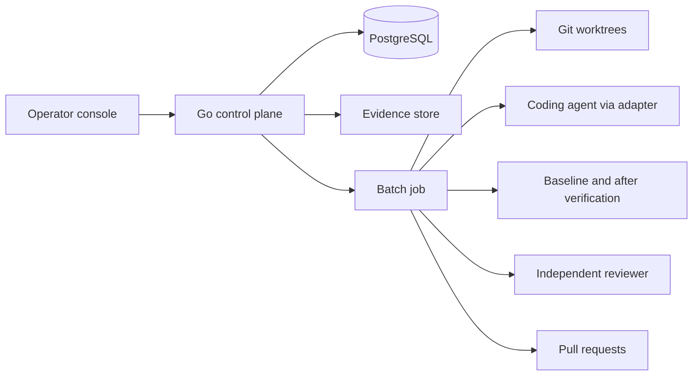

# Defect Drainer — Agent harness for product defects

**Period:** June 2026–Present  
**Ownership:** Founder-led · closed source  
**Role:** Founder / platform engineer  
**Live:** [defectdrainer.com](https://defectdrainer.com) (invite-only)  

Defect Drainer is an agent harness for fixing product defects: report, harness, prove, pull request, resolve. Screenshots and notes become a durable inventory with evidence. A coding agent then fixes selected defects in isolated git worktrees, and a defect does not close until evidence, verification and an independent review all pass. Pull requests are created on the host remote; merge stays on GitHub. It is a multi-tenant service with Google sign-in and invite-only organizations.

The coding agent is a worker inside the harness, not the product. The runner is pluggable.

## How it works

```
Report → Inventory → Batch fix → Verify → Review → Pull request → Close
```

- **Report** — console, HTTP API, or automated detectors push structured defects with evidence. Per-app tokens and idempotent pushes keep intake safe to repeat.  
- **Inventory** — triage by app, severity, area, and reporter.  
- **Batch fix** — isolated worktrees per repo; the live checkout is not edited.  
- **Verify** — operator-authored commands run twice (baseline, then after the agent). Resolve is blocked on regression or a command that cannot run. Pre-existing failures do not block.  
- **Review** — a separate read-only agent run per review lens must pass before a defect resolves.  
- **Ship** — create and refresh PRs; resolve only with fix evidence.  

## Platform



- **Control plane** — one static Go binary with the operator console embedded: inventory, intake, evidence, batches and analytics.  
- **Console** — SvelteKit, usable on phones: onboarding by app, defects, jobs and logs, analytics, per-repo settings.  
- **Sign-in and tenancy** — Google sign-in, invite-only organizations, roles, and an audit log with lifecycle audit on deletes.  
- **Agents** — pluggable adapters for coding-agent CLIs such as Claude Code and Grok Build, running sandboxed on the operator's machine.  
- **Feedback bridge** — pulls learner feedback from other apps into the defect inventory.  

## My contribution

- Product loop and gates: report → inventory → worktree batch-fix → verify → review → PR.  
- Go control plane and SvelteKit operator console.  
- Multi-repo app model (web, mobile, backends as one product).  
- Analytics and verification so a “fixed” defect is something the harness can prove.  

**Key technologies:** Go, SvelteKit, PostgreSQL, git worktrees, GitHub, coding-agent CLIs, containers
