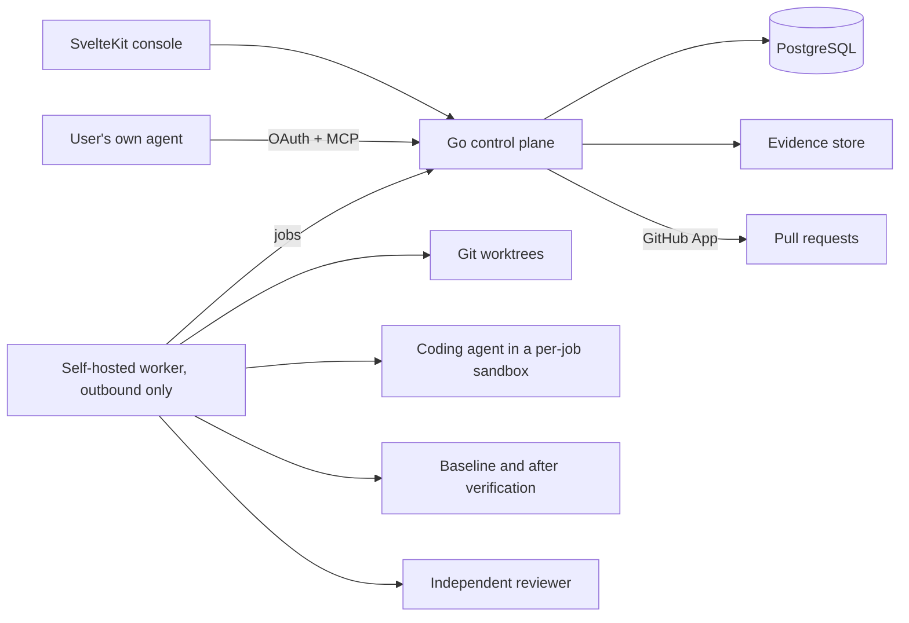

# Defect Drainer — Agent harness for product defects

**Period:** August 2026–Present  
**Ownership:** Founder-led · part of the Agentic SDLC Suite (prove) · closed-source control plane, open-source worker (Apache-2.0)  
**Role:** Founder / platform engineer  
**Live:** [defectdrainer.com](https://defectdrainer.com) · **Worker source:** [github.com/more-than-code/defect-drainer-worker](https://github.com/more-than-code/defect-drainer-worker)  

Defect Drainer is an agent harness for fixing product defects: report, harness, prove, pull request, resolve. Screenshots and notes become a durable inventory with evidence. A coding agent then fixes selected defects in isolated git worktrees, and a defect does not close until evidence, verification and an independent review all pass. Pull requests are opened through a GitHub App; merge stays on GitHub with a person. It is a hosted, multi-organization service with Google sign-in, and its jobs run on workers that users host themselves.

The coding agent is a worker inside the harness, not the product. Any MCP-capable agent can do the work, but only Defect Drainer's own checks decide whether it is done.

## How it works

```
Report → Inventory → Batch fix → Verify → Review → Pull request → Close
```

- **Report** — console, HTTP API, MCP, or automated detectors push structured defects with evidence. Per-project tokens and idempotent pushes keep intake safe to repeat.  
- **Inventory** — triage by app, severity, area, and reporter. A defect that needs a product decision is marked as needing direction, and Won't fix closes one with a reason.  
- **Batch fix** — isolated worktrees per repo; the live checkout is not edited. The agent starts from a written brief: the defects, their acceptance checklist, the repo's contract files and what was already failing.  
- **Verify** — operator-authored commands run twice, in a sandbox (baseline, then after the agent). Resolve is blocked on regression or a command that cannot run. Pre-existing failures do not block. A job can boot a throwaway stack to test against and take after-fix screenshots in a worker browser.  
- **Review** — a separate read-only reviewer must pass before a defect resolves; any critical or high finding blocks the fix.  
- **Ship** — create and refresh PRs; resolve only with fix evidence and a passing verdict.  

## Platform



- **Control plane** — one static Go binary with the operator console embedded: organizations, projects, inventory, intake, evidence, batch jobs and PR status. Released as a container image and deployed through Deploybot.  
- **Console** — SvelteKit, usable on phones: onboarding by app, defects, jobs and live logs, evidence review, analytics and per-repo settings. A job's Chat tab sends messages, images and links to the agent while it works, and an interactive job lets the agent ask questions.  
- **Sign-in and tenancy** — Google sign-in, self-serve organizations, roles, per-project tokens and an audit log.  
- **MCP server** — OAuth-secured, so a user's own agent (Claude Code, a cloud session or any MCP client) signs in as the user to list, claim and report defects, read the same brief a batch job gets, attach evidence and submit a branch. A claim belongs to the session that took it, and Defect Drainer verifies the submitted branch with its own checks and reviewer.  
- **Worker (open source)** — runs on a host the user owns, enrols once with a one-time token, connects out only, and takes only the jobs its root-owned local policy allows. Each job runs the coding agent in an OS sandbox denied the host's credentials, with per-job resource limits, a syscall filter and short-lived per-job GitHub tokens, and reports cost per model.  
- **Agents** — pluggable adapters for coding-agent CLIs: Claude Code on workers, and Claude Code or Grok on an operator's own machine.  

## My contribution

- Product loop and gates: report → inventory → worktree batch-fix → verify → review → PR.  
- Go control plane, SvelteKit operator console and the OAuth-secured MCP server.  
- The open-source worker: outbound-only enrolment, host policy, per-job sandboxes with resource limits and a syscall filter, sandboxed verify, job stacks, a worker browser and messages to a running job's agent.  
- Multi-repo app model (web, mobile, backends as one product) and GitHub App integration.  
- About 1,650 automated tests across the control plane, console and worker.  

**Key technologies:** Go, SvelteKit, TypeScript, PostgreSQL, git worktrees, GitHub Apps, MCP, OAuth, WebSocket, systemd, coding-agent CLIs, containers
