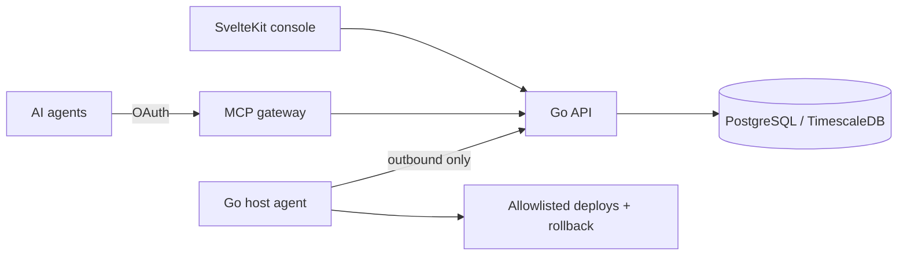

# Deploybot — Self-hosted deploy & operations platform with an AI-agent gateway

**Period:** January 2024–Present  
**Ownership:** Founder-led · public repos  
**Role:** Founder / platform engineer  

Deploybot is a self-hosted deploy and operations platform with an AI-agent gateway, rewritten in October 2026 on Go and SvelteKit. A sandboxed host agent runs allowlisted container and service deploys with health checks and rollback, a Go API keeps projects, encrypted environment sets and an audit log, and an OAuth-secured MCP gateway lets AI agents inspect hosts and make changes only after confirmation.

## Platform

- **Host agent** — sandboxed, outbound-only Go agent (systemd, no listening ports) for allowlisted container and service deploys with health checks and rollback.  
- **API** — Go on PostgreSQL/TimescaleDB with Google sign-in, projects, encrypted environment sets and an audit log.  
- **Console** — SvelteKit operator console.  
- **MCP gateway** — OAuth-secured, exposing 22 tools; changes happen only after confirmation.  

## My contribution

- Host agent, API, operator console and MCP gateway across four public repos: [bot-agent](https://github.com/more-than-code/bot-agent), [bot-api-server](https://github.com/more-than-code/bot-api-server), [bot-console](https://github.com/more-than-code/bot-console), [bot-mcp-server](https://github.com/more-than-code/bot-mcp-server).  
- ~1,100 automated tests across the four repos.

**Key technologies:** Go, PostgreSQL, TimescaleDB, SvelteKit, TypeScript, Docker, systemd, MCP, OAuth, Google sign-in
