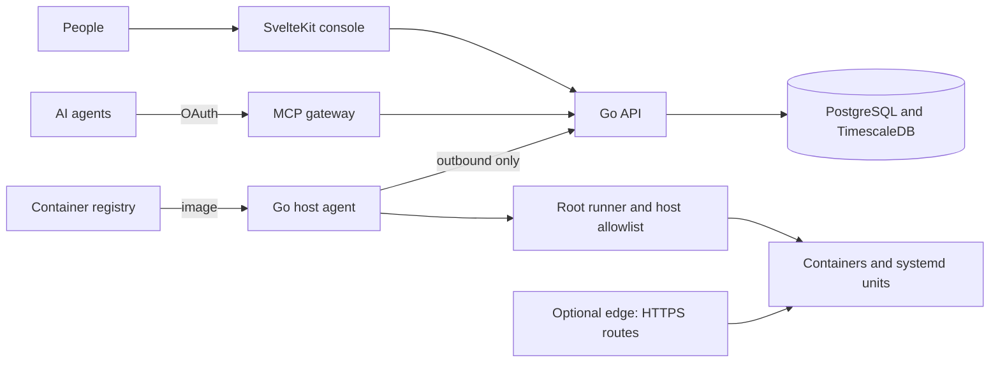

# Deploybot — Self-hosted deploy & operations platform with an AI-agent gateway

**Period:** January 2024–Present  
**Ownership:** Founder-led · open source (AGPL-3.0 server, Apache-2.0 agent)  
**Role:** Founder / platform engineer  
**Live:** [deploybot.dev](https://deploybot.dev) · **Source:** [github.com/more-than-code/deploybot](https://github.com/more-than-code/deploybot)  

Deploybot lets any AI agent that speaks MCP run your own servers, without handing it SSH keys or a cloud token. It can only deploy what your catalog allows, acts as the signed-in user, and every change waits for a confirm step. People use the same controls through a web console. It is a control plane for your own hosts (Raspberry Pis, mini PCs, VPSs, cloud VMs): a small agent on each host dials out, so hosts open no inbound ports. It runs as a hosted service or self-hosted, and was rewritten in October 2026 on Go and SvelteKit.

## Platform

- **Control plane** — one Go server: the API, an OAuth-secured MCP gateway with 40 tools, and the SvelteKit console. Google sign-in, organizations, projects and roles, a catalog, encrypted secrets and an audit log.  
- **Host agent** — one static Go binary under systemd, running unprivileged and dialing out. A root runner checks the host's own allowlist of images, projects and program commands before it runs Docker containers or systemd units.  
- **Safe deploys** — a readiness check before each deploy, a per-service health policy with automatic rollback, and container log limits. Persistent programs run as systemd units with secrets.  
- **Secrets people handle, not AI** — encrypted environment sets with generated values and paste import. An agent can ask for a password, token or file, and a person fills it in on a one-time console page, so the secret never passes through the AI. Registry credentials work the same way.  
- **Public addresses** — verify a domain with a DNS record, and an optional Caddy edge on a host serves HTTPS routes with automatic certificates. Routes go through plan and confirm.  
- **Organizations and hosts** — organizations own hosts, with owner, admin and member roles and per-project host access at metrics or deploy level. Projects on one host can share a network when the host's admin offers it.  
- **Monitoring** — host metrics ingested into TimescaleDB, processes and services, health history and live logs.  
- **Enrolment and upkeep** — a host joins with a one-time token, and the console gives an AI coding agent the prompt to prepare it through the cloud provider's remote tools. A What's new feed in the console and over MCP, update notices for hosts, and a device-code CLI sign-in.  

## My contribution

- Designed and built the platform: host agent, control plane, MCP gateway and operator console.  
- The safety model for AI access: acts as the signed-in user, plan and confirm on every change, host-side allowlist, and secrets entered by people.  

**Key technologies:** Go, PostgreSQL, TimescaleDB, SvelteKit, TypeScript, Caddy, Docker, systemd, MCP, OAuth, Google sign-in
