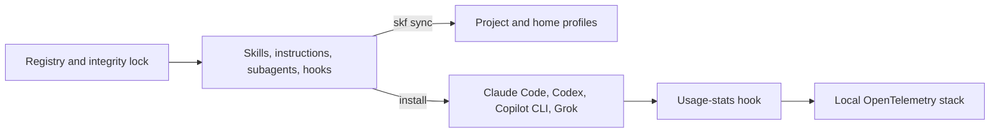

# Skill Forge — Agent skills and instructions registry

**Period:** June 2026–Present  
**Ownership:** Founder-led · open-source (MIT)  
**Role:** Founder / platform engineer  
**Repo:** [github.com/more-than-code/skill-forge](https://github.com/more-than-code/skill-forge)  

Skill Forge is an open-source Node.js CLI and registry for the artifacts that steer AI coding agents: skills, managed instructions, subagents and hooks. It distributes them to Claude Code, Codex, Copilot CLI and Grok as SHA-256 integrity-locked, versioned packages. Each repository declares the skills it needs in a profile, and `skf sync` vendors exact copies into it, so a repo carries its own agent setup even where the home machine's skills don't reach, such as a cloud session or another machine. The registry is the source of truth; tool runtime folders are install targets.

## Platform

- **Registry** — every artifact tracked with a SHA-256 integrity lock, like a package-lock.  
- **Skills** — 41 installable skills, from coding discipline and security to frontend, testing and multi-session workflow roles.  
- **Subagents and instructions** — 16 managed subagent definitions across the four tools, and managed instructions composed from a shared core plus one overlay per tool.  
- **Profiles and sync** — project and home profiles; `skf sync` vendors exact copies, and `sync --check` detects drift. A local overlay covers a single checkout such as a git worktree.  
- **Per-project instructions** — opt-in variants rendered into a repo's own agent instruction files inside marked blocks.  
- **Hooks** — enforcement hooks for Claude Code (a git guard that blocks commits outside the session's project and asks before main, and a skill-profile staleness check at session start) and a metadata-only usage-stats hook.  
- **Validation** — metadata, paths and lock freshness are checked, and installs diff before overwriting.  

## My contribution

- Registry and integrity-lock model, and the profile sync CLI.  
- Multi-tool instruction composition, subagent and hook installs.  
- Skills written and revised from real multi-session agent work: session roles, worktree discipline and parity gates for mirrored clients.  
- An automated test suite of 216 tests.  

**Key technologies:** Node.js, CLI, registry and lock JSON, skill frontmatter, OpenTelemetry
