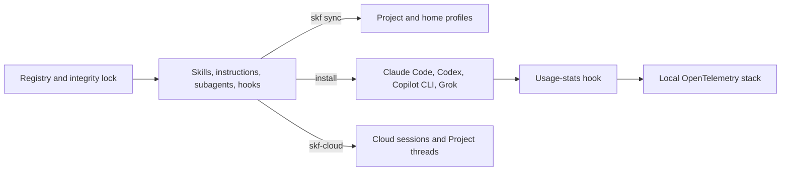

# Skill Forge — Agent skills and instructions registry

**Period:** June 2026–Present  
**Ownership:** Founder-led · part of the Agentic SDLC Suite (develop) · open source (MIT)  
**Role:** Founder / platform engineer  
**Source:** [github.com/more-than-code/skill-forge](https://github.com/more-than-code/skill-forge)  

Skill Forge is an open-source Node.js CLI and registry for the artifacts that steer AI coding agents: skills, managed instructions, subagents and hooks. It distributes them to Claude Code, Codex, Copilot CLI and Grok as SHA-256 integrity-locked, versioned packages. Each repository declares the skills it needs in a profile, and `skf sync` vendors exact copies into it, or, in cloud agent sessions, installs them from a pinned registry commit so the repository commits only its manifest. The registry is the source of truth; tool runtime folders are install targets.

Alongside the distribution mechanism is the content: an engineering process, written as instructions and skills, that agents actually follow: risk tiers, explore → spec → implement, mandatory gate evidence, independent review lenses and git safety.

## Platform

- **Registry** — every artifact tracked with a SHA-256 integrity lock, like a package-lock; a stale lock is a validation error.  
- **Skills** — 42 installable skills, from coding discipline and security to frontend, testing, product parity and multi-session workflow roles. Activation is metadata-first, so a large library costs almost nothing until a skill is used.  
- **Subagents and instructions** — 16 managed subagent definitions across the four tools, and managed instructions composed from a shared core plus one overlay per tool.  
- **Profiles and sync** — project and home profiles; `skf sync` vendors exact copies, and `sync --check` detects drift. A local overlay covers a single checkout such as a git worktree.  
- **Cloud delivery** — `skf-cloud`, one dependency-free Node file that a cloud environment's setup script fetches at a pinned registry commit. It installs the rules, subagents and every skill each cloned repository's manifest names, and a read-only `doctor` checks the setup, the repositories and the Project instructions, saying who fixes each finding.  
- **Per-project instructions** — opt-in variants rendered into a repo's own agent instruction files inside marked blocks, including a compact cloud variant.  
- **Hooks** — enforcement hooks for Claude Code (a git guard and a skill-profile staleness check) and a metadata-only usage-stats hook.  

## My contribution

- Registry and integrity-lock model, and the profile sync CLI.  
- Multi-tool instruction composition, subagent and hook installs, and cloud delivery with its doctor.  
- The shared engineering process and the 42-skill library, written and revised from real multi-session agent work.  
- An automated test suite of 254 tests.  

**Key technologies:** Node.js, CLI, registry and lock JSON, skill frontmatter, OpenTelemetry, Prometheus, Grafana
