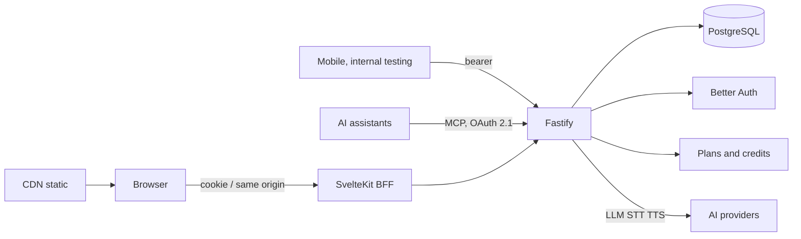
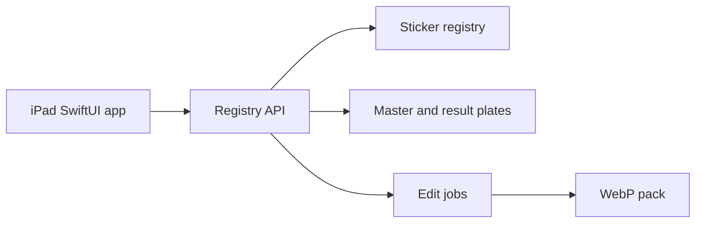

# Tutored — AI language coach

**Period:** July 2026–Present  
**Ownership:** Founder-led  
**Role:** Founder / platform owner  
**Live:** [tutored.app](https://tutored.app)  

Tutored is a language coach that explains in the language you already know. Learners chat with Pip, a kiwi coach, about a word, sentence or grammar point, or send a photo of their own word list or textbook page and turn it into a drill. They practise by saying it aloud, writing it down or translating, and every word they learn is kept in their own dictionary with meanings in their language.

## Platform

SvelteKit is a same-origin BFF for the **web** (httpOnly cookies, streamed LLM). Fastify is the system of record: auth, plans and credits, speech, and data. **Mobile clients talk to Fastify directly** with bearer tokens, not through the BFF; the mobile app is in internal testing. Hashed web assets sit on a CDN.



- **Identity:** Better Auth — email sign-up, verification and reset, and Google sign-in; one model for web cookies and mobile bearer tokens.  
- **Plans and credits:** Fastify meters AI use per user against a 30-day credit allowance, enforced as middleware.  
- **Data:** PostgreSQL (Drizzle) for multi-tenant accounts, usage, and learning records.  
- **Ops:** request-correlated logs, product events, metrics; automated backup and restore; CI/CD to Vercel, with data on Supabase.

## Features

- **Coach chat** — chat with Pip in your own language; save a word from a reply to your dictionary with one tap; chats stay in step across devices.  
- **Photo to practice** — a photographed page or word list becomes practice items.  
- **Practice modes** — Read Aloud (answer by voice, graded against the written term), Dictation (typed, or a photo of handwriting) and Translation (typed or voice).  
- **Study log and strategies** — every session records outcomes and weaknesses, feeding mistake re-tests, spaced-repetition review and extended exercises on the same theme.  
- **Dictionary and library** — a personal dictionary with meanings in your language and a private library of documents, images and videos.  
- **Accounts and credits** — email or Google sign-in, account security pages, a free plan with a credit allowance and usage meter, and a small daily allowance for guests before they sign up.  
- **Connected AI assistants** — an MCP server with OAuth 2.1 lets a learner connect an AI assistant to their own dictionary and practice records, managed under Settings → Connected apps.  
- **Languages** — interface in English, Japanese, French and Chinese (Simplified and Traditional), with light, dark and system themes.  

## Content ops (internal)

For internal use for now. Curriculum is a publish pipeline, not an in-app CMS.

```text
author packs  →  validate  →  publish  →  catalog / enroll / study
```

A pack is one enrollable SKU (`pack.json` + assets). Studio: React console, Fastify authoring API, Zod schema and CLI.

## Sticker studio (internal)

For internal use for now. Sketch Forge is the creator tool behind Tutored's stickers: an iPad-first native iOS app (Swift, SwiftUI) for sticker QA and publish. Stickers are imported, reviewed, edited additively, approved, then shipped as a WebP pack that the web and mobile clients consume. The UI is Apple-native, not a web view, and it talks to a registry API over REST.

- **Library** — grid, status and tag filters, search, multi-select approve or flag
- **Review** — master vs checker / light / dark plates, defect tags, comments
- **Compare** — candidate vs revision, enqueue edit jobs, set the official candidate
- **Publish** — approved plates become a market pack for downstream apps



## Product design

- The coach **proposes**; the learner **approves** — no silent tool side-effects.  
- Live voice input uses on-device speech recognition; read-aloud grading is a local text diff and TTS is cached, so model spend stays on generation and explanation.  
- Agent tools are allowlisted and owner-scoped. Learner notes are data, not instructions.

## My contribution

- SaaS topology: Fastify API, thin SvelteKit BFF for web, mobile on the same API (not via BFF).  
- Auth, plans and credit metering as middleware — not per-handler special cases.  
- MCP server with OAuth 2.1 so learners can connect their own AI assistants to their data.  
- Content factory: pack model, validate/publish, catalog sync.  
- Speech and agent path designed so cost and data scope stay bounded.  
- Sketch Forge: the Swift / SwiftUI iPad client for sticker library, review, compare and publish, with explicit candidate and approved pointers so review never invents a revision.  

**Key technologies:** TypeScript, Fastify, SvelteKit, Swift, SwiftUI, PostgreSQL, Better Auth, MCP, OAuth 2.1, Vercel, Supabase
