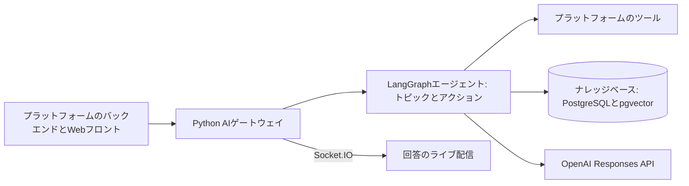

# AIHub — ホワイトレーベルAIプラットフォームのAIゲートウェイ

**期間:** 2025年6月〜2026年1月
**区分:** 個人事業主としての契約（商用）
**役割:** AIエンジニア（AIゲートウェイ）、DevOps（兼務）

AIHubは、AIマーケティングと教育ガイダンスを扱う、企業向けのホワイトレーベルAIプラットフォームです。私はPython製のAIゲートウェイを開発しました。プラットフォームのJavaバックエンドがこれを呼び出し、ナレッジベースに基づく回答や構造化されたAIレポートを取得し、回答はリアルタイムでユーザーにストリーミングされます。あわせてプラットフォームのDevOpsも担当しました。

## プラットフォーム

- **エージェント** — LangGraph上のトピック＆アクション型エージェント。プラットフォーム側のトピックがアクションを宣言し、エージェントが呼び出しのタイミングを判断して、検索から説明までをつなぎます。
- **ナレッジベース** — ドキュメントコレクション、チャンク分割、AIによるメタデータ抽出、メタデータフィルタ付きのセマンティック検索、PDF取り込み。PostgreSQLとpgvectorで構築。
- **モデル層** — OpenAI Responses API向けのLLMアダプタ（推論の制御とWeb検索に対応）。
- **ストリーミング** — 回答と推論ステップをSocket.IOで適切なクライアントへ配信。
- プラットフォームのバックエンドとWebフロントは他の開発者が開発し、ゲートウェイはそれらが呼び出すAI層です。

## 担当範囲

- ゲートウェイのエージェントフロー、ナレッジベース、モデル層、リアルタイム配信を設計・開発。
- エージェントをLangGraph 1.0へ移行し、データベースアクセスを非同期化し、2段階のDockerビルドを追加。
- プラットフォームのDevOpsを兼務: AWSでの運用（EC2、S3、CloudFront、ALB、IAM、CloudWatch）、CI/CDパイプライン、Dockerデプロイ。

**主な技術:** Python, FastAPI, LangGraph, LangChain, OpenAI Responses API, PostgreSQL, pgvector, Socket.IO, Docker, AWS
